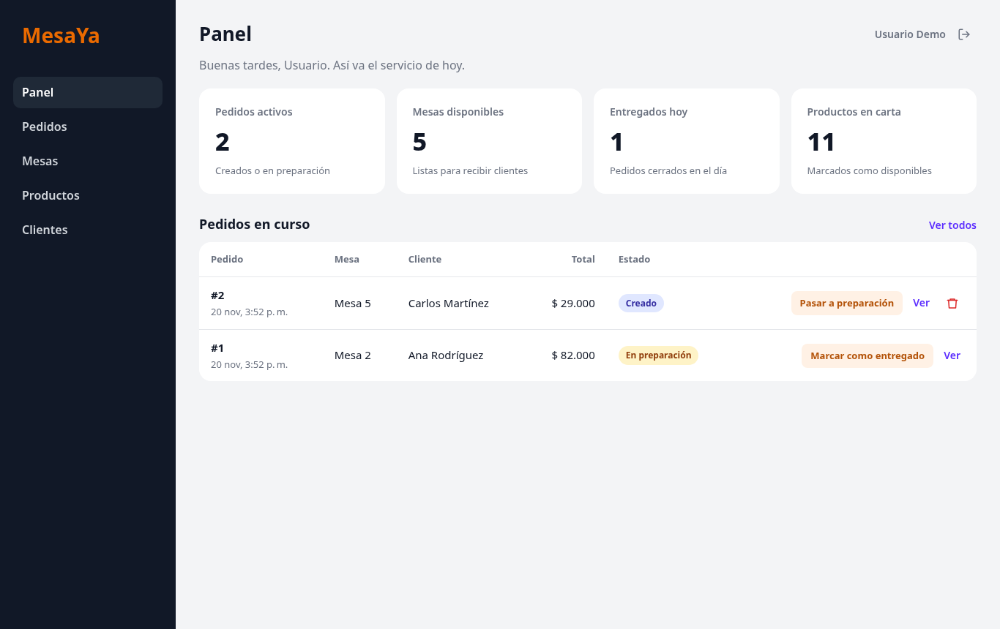
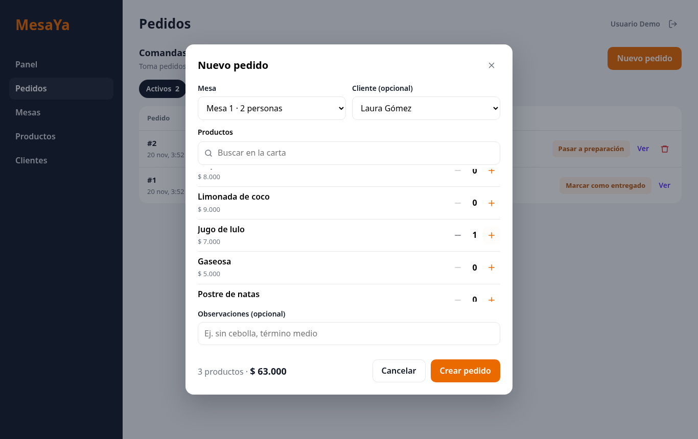
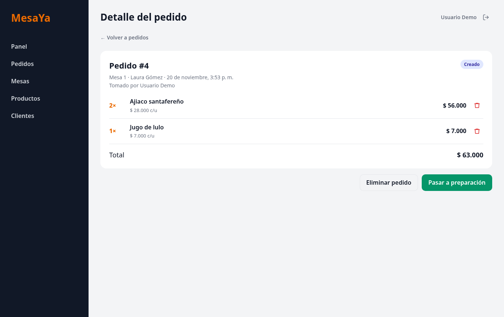
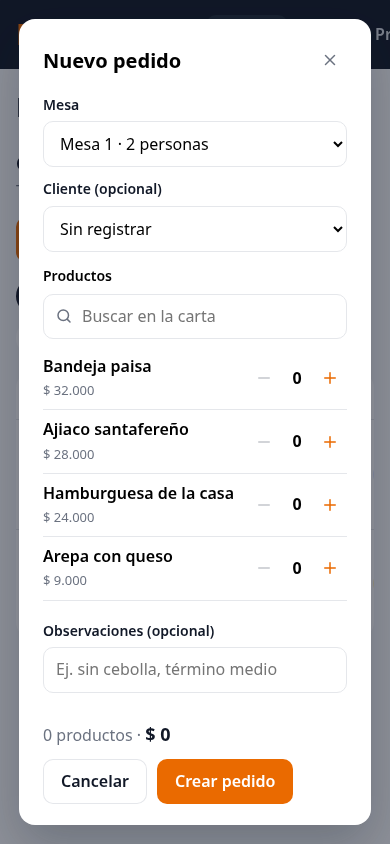

# MesaYa

Panel web para la operación diaria de un restaurante: mesas, carta, clientes y pedidos, desde que se toma la comanda hasta que se entrega.

**Demo:** https://eliasgdev.github.io/mesaya/ — entra con la cuenta de demostración (`demo@mesaya.co` / `MesaYa2026`) o crea una cuenta.

> La API corre en el plan gratuito de Render: si lleva un rato sin uso, la primera carga tarda alrededor de un minuto mientras se enciende. Los datos de la demo se reinician con cada despliegue.



## Qué hace

- **Pedidos:** se crean eligiendo la mesa, el cliente (opcional) y los productos con su cantidad. El total se calcula en vivo. Cada pedido avanza de *Creado* → *En preparación* → *Entregado*.
- **Mesas:** al tomar un pedido la mesa queda ocupada, y se libera sola cuando el pedido se entrega o se elimina. Una mesa ocupada no admite un segundo pedido.
- **Carta:** productos con categoría, precio, stock y disponibilidad. Un producto que ya aparece en pedidos no se borra: se marca como no disponible para no romper el historial.
- **Clientes:** registro con búsqueda por nombre, correo o teléfono.
- **Panel:** pedidos activos, mesas libres, entregados del día y productos en carta.

| Nuevo pedido | Detalle del pedido | Celular |
|---|---|---|
|  |  |  |

## Tecnología

| Capa | Stack |
|---|---|
| API | Java 21, Spring Boot 3.5, Spring Data JPA / Hibernate, Spring Security (JWT HS256), Bean Validation |
| Base de datos | SQLite por defecto; PostgreSQL con el perfil `postgres` |
| Web | Angular 21 con componentes standalone y signals, diseño atómico (átomos, moléculas, organismos) |
| Calidad | Pruebas de integración con MockMvc, pruebas unitarias con Vitest, CI en GitHub Actions |
| Despliegue | API en Docker sobre Render · web estática en GitHub Pages |

### Arquitectura de la API

Organizada por dominio (`auth`, `producto`, `mesa`, `cliente`, `pedido`, `dashboard`), cada uno con `controller → service → repository`, DTO de entrada y salida, y un manejador global de errores que responde siempre con el mismo formato:

```json
{ "status": 400, "mensaje": "La mesa 2 ya está ocupada." }
```

### Seguridad

- Toda la API exige un token JWT, salvo login, registro y el health check.
- El usuario que toma un pedido sale del token, no de lo que envía el cliente.
- Contraseñas con BCrypt. El login responde igual si el correo no existe o si la clave es incorrecta, y compara el hash en ambos casos para no revelar qué correos están registrados.
- No se puede quitar un ítem que pertenece a otro pedido, aunque se conozca su id.
- CORS limitado al dominio del frontend. Los errores internos se registran en el servidor sin exponer trazas.

## Correr en local

Requisitos: JDK 21, Maven y Node 22.

```bash
# API en http://localhost:9000
cd api
mvn spring-boot:run

# Web en http://localhost:4200
cd web
npm install
npm start
```

La primera vez que arranca, la API crea `mesaya.db` con un restaurante de ejemplo y el usuario demo.

### Variables de entorno de la API

| Variable | Para qué | Por defecto |
|---|---|---|
| `PORT` | Puerto HTTP | `9000` |
| `JWT_SECRET` | Clave para firmar los tokens (mínimo 32 caracteres) | Se genera una al azar en cada arranque |
| `CORS_ORIGINS` | Orígenes permitidos, separados por coma | `http://localhost:4200` |
| `DB_URL` | URL JDBC | `jdbc:sqlite:mesaya.db?foreign_keys=true` |
| `DEMO_DATOS` | Cargar datos de ejemplo si la base está vacía | `true` |
| `SPRING_PROFILES_ACTIVE` | `postgres` para usar PostgreSQL (con `DB_URL`, `DB_USER`, `DB_PASSWORD`) | — |

### Pruebas

```bash
cd api && mvn verify          # integración: autenticación, flujo de pedidos, reglas de negocio
cd web && npx ng test --watch=false
```

## Endpoints principales

| Método | Ruta | Descripción |
|---|---|---|
| POST | `/api/auth/registro` · `/api/auth/login` | Devuelven `{ token, expiraEnSegundos, usuario }` |
| GET | `/api/auth/perfil` | Usuario de la sesión |
| GET/POST/PUT/DELETE | `/api/productos`, `/api/mesas`, `/api/clientes` | CRUD |
| GET/POST | `/api/pedidos` | Listar (filtro `?estado=`) y crear |
| PATCH | `/api/pedidos/{id}/estado` | Avanzar al siguiente estado |
| POST/DELETE | `/api/pedidos/{id}/detalles[/{idDetalle}]` | Agregar o quitar productos |
| GET | `/api/dashboard/resumen` | Indicadores del panel |

## Origen

MesaYa empezó como proyecto final de la materia DSI3 en la Universidad El Bosque (2026-1): el backend en Spring Boot y la maqueta de pantallas en Angular con diseño atómico. Después del semestre lo terminé: autenticación con JWT, conexión de todas las pantallas a la API, reglas de negocio, pruebas y despliegue.
